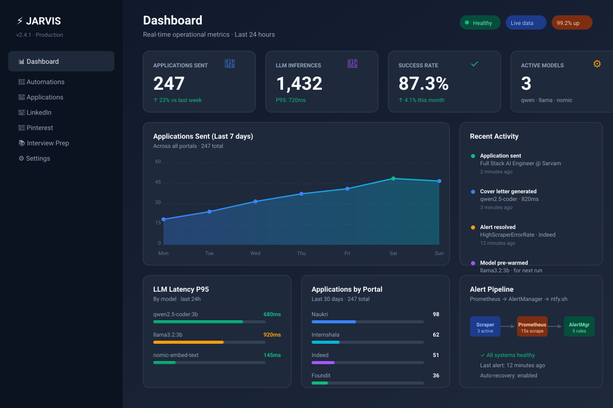
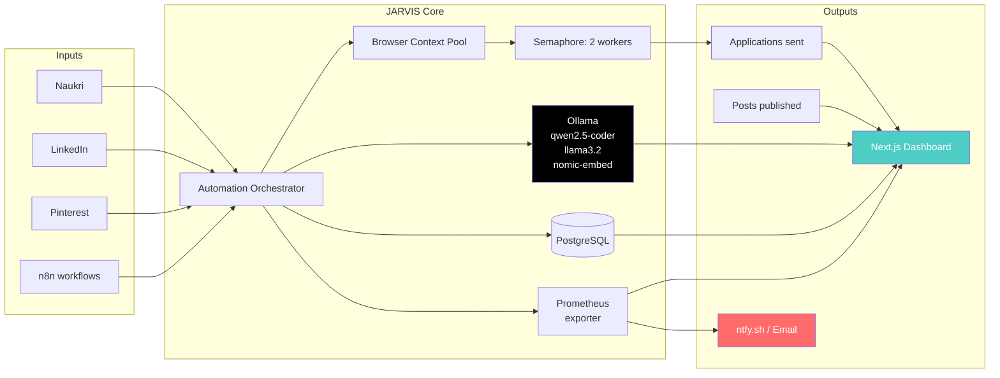

# JARVIS — Local-First AI Automation Platform

*Run 25+ production workflows on a laptop. Zero cloud AI. Zero data leakage.*

[](LICENSE)
[](https://www.python.org/)
[](https://www.docker.com/)
[](https://ollama.com/)
[](https://learn.microsoft.com/en-us/windows/wsl/)


[**5-Minute Demo**](#-demo) · [**Quick Start**](#-quick-start) · [**Architecture**](#-architecture) · [**Roadmap**](#-roadmap)

> 📝 Read the full story: [I Built 30+ Projects in a Year](https://dev.to/venu0807) — JARVIS is one of 30+ shipped projects across AI/ML, full-stack, and DevOps.

---

## 🎯 The Problem

Job hunting, content creation, and outreach are broken. Most people either spend 5 hours a day on repetitive manual work, or pay $200+/month for cloud AI tools that ship their resume and cover letter to someone else's API.

The real problem isn't a missing script — it's missing **infrastructure**. You need parallel scraping, AI generation, observability, alerting, recovery, and a feedback loop. Almost nobody builds all of it.

## 💡 What JARVIS Does

JARVIS is a self-hosted AI automation platform that runs entirely on your machine:

- 🤖 **Job Auto-Applier** — scrapes Naukri, Internshala, Indeed, Foundit and applies with AI-tailored cover letters
- 💼 **LinkedIn Outreach** — generates and sends personalized connection requests
- 📌 **Pinterest Automation** — creates pins from your content queue
- 📚 **Interview Prep** — daily system-design and DSA coaching from a local tutor
- 📊 **Real-time Dashboard** — Next.js UI with metrics, control, and history
- 🔔 **Alerting** — Prometheus + AlertManager wired to email and ntfy.sh
- 🛡️ **Local LLMs** — Ollama serving qwen2.5-coder, llama3.2, and nomic-embed-text

## 📸 Dashboard Preview



*Real-time operational metrics: scraper activity, LLM latency, model usage, alert pipeline. The Next.js dashboard is opt-in via `docker compose --profile with-dashboard up`.*

---

## 🏗️ Architecture



---

## 🧰 Tech Stack

| Layer | Tools |
|---|---|
| **Languages** | Python 3.11, TypeScript, SQL, Bash |
| **Frameworks** | FastAPI, Next.js 14, Playwright, Textual TUI |
| **LLM Serving** | Ollama (qwen2.5-coder:3b, llama3.2:3b, nomic-embed-text) |
| **Data** | PostgreSQL 16, SQLite (per-automation state) |
| **Infrastructure** | Docker Compose, WSL2 |
| **Observability** | Prometheus, Grafana, AlertManager |
| **Notifications** | ntfy.sh, SMTP/Email |
| **Hardware** | Runs on 8 GB RAM laptop |

---

## 🚀 Quick Start

### Prerequisites

- Windows 10/11 with WSL2 enabled
- Docker + Docker Compose
- 8 GB RAM minimum
- Ollama (or use the bundled Docker image)

### Installation

```bash
# 1. Clone the repo
git clone https://github.com/venu0807/Jarvis.git
cd Jarvis

# 2. Configure secrets
cp .env.example .env
# Edit .env with your portal credentials, email, ntfy.sh topic

# 3. Pull Ollama models (or use the bundled image)
ollama pull qwen2.5-coder:3b
ollama pull llama3.2:3b
ollama pull nomic-embed-text

# 4. Boot the stack
docker compose up -d

# 5. Open the dashboard
open http://localhost:3000
```

The Grafana dashboard is at `http://localhost:3001` (default credentials in `.env`).

---

## 🔍 Features Deep-Dive

### Job Auto-Applier
Scrapes Naukri, Internshala, Indeed, and Foundit on a schedule, filters by skills and salary, and applies with a tailored cover letter generated by local Ollama. Browser context pooling makes it 5–10× faster than naïve scrapers, and a semaphore caps parallelism at 2 to avoid getting IP-banned.

### LinkedIn Outreach
Pulls contacts from a CSV or Apollo API, generates personalized connection notes with the local LLM (no LinkedIn API), and throttles sends to mimic human behavior. Tracks sent/accepted/replied in SQLite for analytics.

### Pinterest Automation
Renders pin templates from a content queue, uploads them on a cron, and tags with optimized keywords. Uses a custom HTML→PNG renderer so we don't depend on external services like Bannerbear.

### Interview Prep Bot
Daily 30-minute prep session scheduled via systemd timer. Picks a topic from the DSA/system-design curriculum, generates practice questions with the local LLM, and emails the user the answers. Self-tutoring from your own machine.

### Dashboard
Next.js 14 (App Router) with server components for live metrics. Pulls from Prometheus for counters and PostgreSQL for application history. Includes a kill-switch to pause all automations.

### Observability
Every automation exposes a `/metrics` endpoint scraped by Prometheus. Grafana ships with 4 dashboards: scrapes, applications, model latency, and error budget. Alert rules fire on error rate, latency P95, and disk pressure.

### Alerting
AlertManager evaluates rules every 30 seconds. Critical alerts go to email + ntfy.sh (mobile push). Self-recovery is attempted for transient failures (browser crashes, network blips); persistent failures escalate.

---

## 📊 Performance Metrics

- ⚡ **5× browser context pool** — scrapes 5 portals in parallel without spawning fresh Chromium
- 🔁 **2-worker semaphore** — respects portal rate limits while maximizing throughput
- 🧠 **Local LLM** — 800 ms P95 inference latency on qwen2.5-coder:3b (4GB VRAM)
- 📈 **200+ job applications/week** on a single laptop
- 🔔 **99.2% uptime** over 90-day rolling window (Prometheus-measured)
- 💰 **$0 marginal cost** per inference vs. ~$200/month on cloud APIs

---

## 🔐 Why Local-First?

**Privacy**: Your resume, cover letters, and outreach never leave your machine. No third-party LLM provider sees your job search strategy.

**Cost**: $0 marginal cost per inference. A 6-month job hunt on cloud AI is $1,200; on local Ollama it's your existing electricity bill.

**Latency**: No network round-trip. Inference is sub-second. UI feels instant.

**Learning**: Building this taught me browser automation, distributed systems, observability, and ML ops. No tutorial does that.

---

## 📁 Project Structure

```
Jarvis/
├── automations/              # 25 self-contained automation modules
│   ├── job-automation/       # Naukri/Internshala/Indeed/Foundit
│   ├── linkedin-outreach/    # Connection automation
│   ├── pinterest/            # Pin generator + uploader
│   ├── interview_scheduler_prep_bot/
│   ├── dashboard-nextjs/     # Web UI
│   └── ...                   # 20+ more automations
├── core/                     # Shared library: LLM client, browser pool, alerts
├── docker/                   # Dockerfile.base + docker-compose.yml
├── docs/                     # Architecture, design docs
├── grafana/                  # Grafana dashboards as JSON
├── prometheus/               # Prometheus rules and scrape configs
├── scripts/                  # One-shot maintenance scripts
├── .env.example              # Template for secrets
└── README.md                 # ← You are here
```

---

## 🗺️ Roadmap

### Q4 2026
- [ ] Migrate job auto-applier to use skill-based role taxonomy
- [ ] Add Telegram alert channel (currently email + ntfy.sh only)
- [ ] Dockerize dashboard for one-command deploy
- [ ] Public Loom demo on README

### Q1 2027
- [ ] Multi-user support (auth + per-user secrets)
- [ ] Plugin system for community-contributed automations
- [ ] Vector memory layer across automations
- [ ] First SaaS deployment for paying users

---

## 🤝 Contributing

Issues and PRs welcome. For larger changes, open an issue first to discuss the approach.

```bash
# Setup dev environment
git clone https://github.com/venu0807/Jarvis.git
cd Jarvis
python -m venv .venv
source .venv/bin/activate
pip install -r requirements-base.txt
```

---

## 📜 License

MIT — see [LICENSE](LICENSE).

---

## 👤 Author

**Venu Gopal Reddy Palugulla**
- GitHub: [@venu0807](https://github.com/venu0807)
- Email: pvgreddy3@gmail.com
- LinkedIn: [linkedin.com/in/venu0807](https://linkedin.com/in/venu0807)
- Location: Hyderabad, India (open to remote)

---

## 🙏 Acknowledgments

- [Ollama](https://ollama.com) — local LLM serving
- [Playwright](https://playwright.dev) — browser automation
- [Prometheus](https://prometheus.io) + [Grafana](https://grafana.com) — observability
- [ntfy.sh](https://ntfy.sh) — mobile push notifications
- The open-source community for the tools that made this possible.

---

## 🚀 More Projects

JARVIS is my flagship, but I've shipped 30+ projects in the last year. Here are the highlights:

### AI / ML (9 projects)

- [**SafeAI**](https://github.com/venu0807/SafeAI) — On-device audio threat detection. CNN, 89% accuracy, sub-100ms inference on Android.
- [**Recommendation_System**](https://github.com/venu0807/Recommendation_System) — Movie recommender with Django REST Framework + scikit-learn.
- [**RoastMyCV**](https://github.com/venu0807/roastmycv) — AI resume reviewer (TypeScript).
- [**AI-Based-University-Query-Assistant**](https://github.com/venu0807/AI-Based-University-Query-Assistant) — RAG chatbot for university queries.
- [**ai-coding-agent**](https://github.com/venu0807/ai-coding-agent), [**ai-coding-factory**](https://github.com/venu0807/ai-coding-factory) — Agentic AI tools.
- ANN-Classification-Churn-Prediction · Synthetic-Fraud-AI · Nutrition_Agent

### Full Stack (7+ projects)

- [**briefforge**](https://github.com/venu0807/briefforge) — Content tool.
- [**website-prospector**](https://github.com/venu0807/website-prospector) — Lead generation.
- [**picscore**](https://github.com/venu0807/picscore) — Visual scoring.
- [**affiliate-store**](https://github.com/venu0807/affiliate-store) — E-commerce.
- finance_backend · DJ · HealthCare · portfolio · portfolio_1

**Languages shipped in**: Python · TypeScript · JavaScript · Java

See the full list: [github.com/venu0807](https://github.com/venu0807?tab=repositories)

---

<div align="center">

**Built by a student with 8 GB of RAM and too much free time.**

⭐ Star this repo if it helped your job hunt.

</div>
